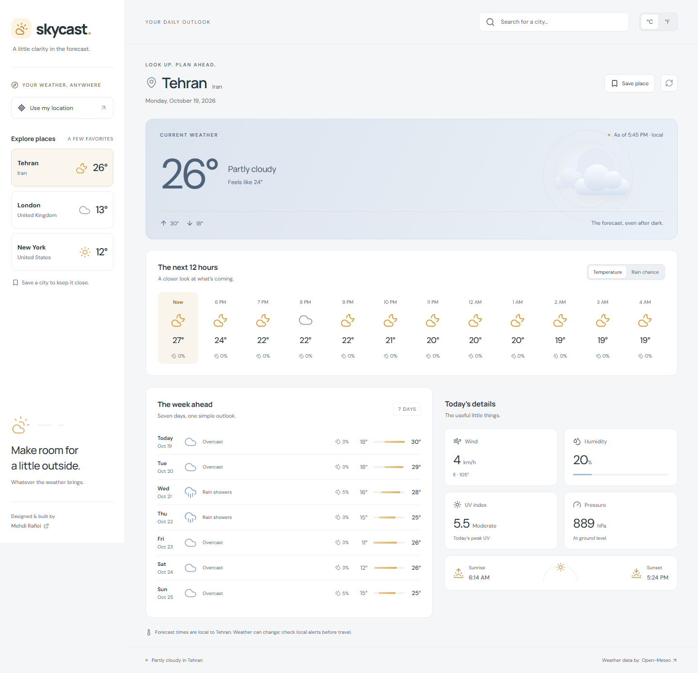
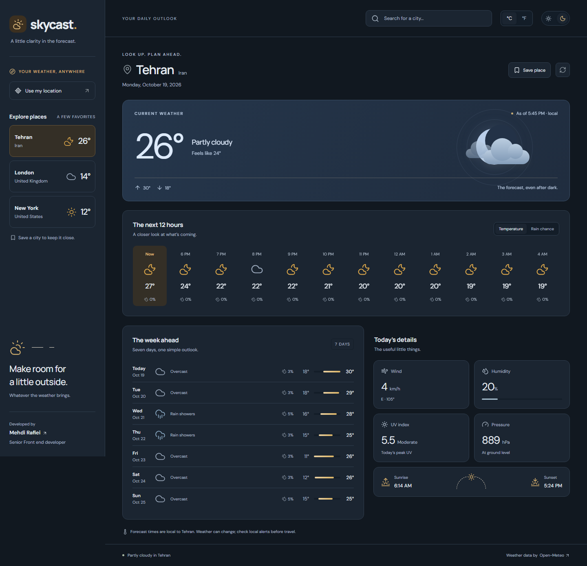
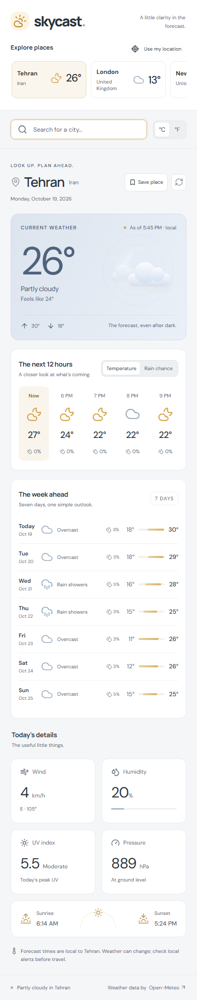
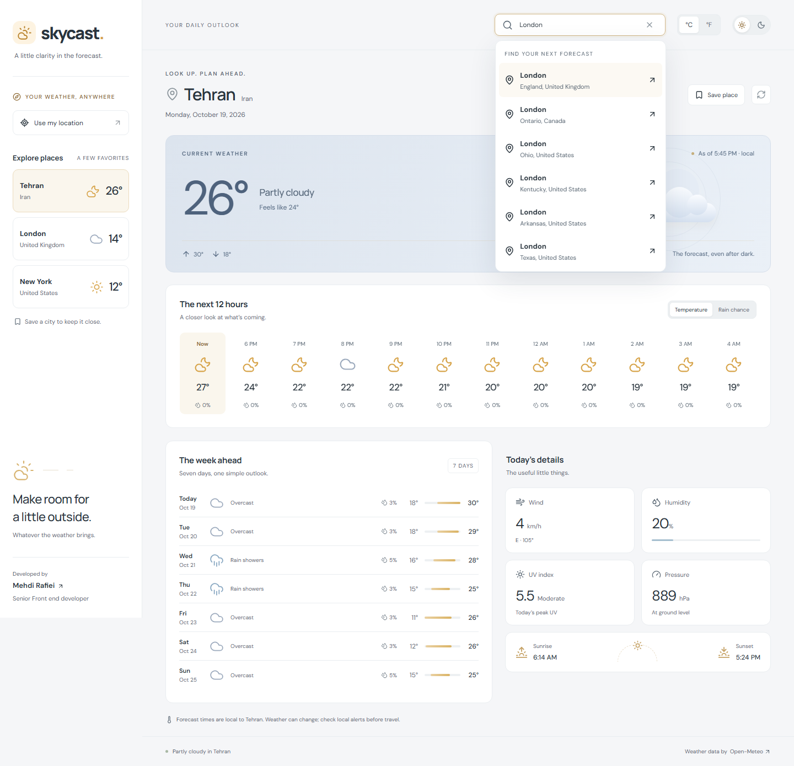

# Skycast

A weather dashboard built with React 19, TypeScript, Vite, and TanStack Query. Search for a city, check the next few hours, and see how the rest of the week is shaping up.

**Live demo:** [https://skycast-weather-mehdispace.netlify.app/](https://skycast-weather-mehdispace.netlify.app/)

| Light theme                                                                                                                | Dark theme                                                                                                             |
| -------------------------------------------------------------------------------------------------------------------------- | ---------------------------------------------------------------------------------------------------------------------- |
|  |  |

## What’s inside

- Current conditions, feels-like temperature, and daily highs and lows.
- Twelve hours of temperature and rain probability, plus a seven-day forecast.
- Wind, humidity, surface pressure, peak UV, sunrise, and sunset.
- City search with a short debounce, keyboard navigation, and country/region labels.
- Browser location, saved places, and Celsius/Fahrenheit preferences.
- Light and dark themes, with a saved preference and a system-based default.
- Shareable city URLs that work with browser back and forward navigation.
- Loading, empty, offline, and retry states. An unsuccessful refresh keeps the last forecast visible.

Forecasts come from [Open-Meteo](https://open-meteo.com/). There’s no API key to set up. Location access is requested only when you click **Use my location**; Tehran is the initial view.

<details>
<summary>Mobile view and city search</summary>





</details>

## Run locally

Use Node.js 22.14 or newer. The project includes an `.nvmrc` for Node 22.

```sh
npm ci
npm run dev
```

Open <http://localhost:5173>. No environment file is needed for the default setup.

To change API endpoints, copy `.env.example` to `.env`:

```dotenv
VITE_WEATHER_API_URL=https://api.open-meteo.com/v1/forecast
VITE_GEOCODING_API_URL=https://geocoding-api.open-meteo.com/v1/search
```

These are complete endpoint URLs. Custom endpoints must return the same response format as Open-Meteo. Vite exposes `VITE_` values in the browser bundle, so don’t put secrets here. Restart the dev server after changing them.

## A few implementation choices

This is one interactive screen, so React and Vite are enough. There’s no server rendering requirement or server-side secret to justify a full-stack framework.

TanStack Query owns the remote data: caching by coordinates, cancelling obsolete requests, retrying once, and refreshing forecasts every 15 minutes. Forecasts stay fresh in the cache for ten minutes. Temperature conversion happens locally, so switching units doesn’t make another request.

Zod validates API responses before they reach the UI, including the lengths of the parallel forecast arrays. The API adapter then maps provider field names to the smaller model the components use. Saved browser data and URL coordinates are validated too.

Local React state handles the selected city and UI preferences. Saved places and units use `localStorage`; links carry city coordinates in the query string. A separate global state library or router wouldn’t add much here.

All forecast times use the destination’s local time. The UI avoids converting the API’s local timestamps through the viewer’s timezone.

```text
src/
  app/                 Application layout and interactions
  features/
    places/            City search, saved places, URL state
    weather/           API adapter, query options, forecast views, formatting
  lib/                 Shared HTTP handling
  main.tsx             React root and query provider
  styles.css           Responsive layout and weather illustrations
e2e/                   Browser tests
scripts/               Live API checks and screenshot capture
docs/screenshots/      Screenshots of the running app
```

## Checks

```sh
npm run lint
npm test
npm run build
```

Unit and interaction tests cover response validation, unit conversion, local-time formatting, corrupt storage, and keyboard search. They use controlled responses and don’t depend on the weather service being available.

Browser checks cover search, saved places, units, browser history, location permissions, API recovery, offline messaging, and accessibility at desktop and mobile sizes:

```sh
npx playwright install chromium
npm run test:e2e
```

Check the actual endpoints for Tehran, London, and New York:

```sh
npm run check:api
```

To refresh the README screenshots, start the app in one terminal and run `npm run screenshots` in another. This captures real API data. Set `APP_URL` to capture a deployed instance instead.

## Deploy to Netlify

1. Create an empty GitHub repository named `skycast-weather` and push this project to it.
2. In Netlify, choose **Add new project → Import an existing project**, then connect the GitHub repository.
3. Keep the base directory at the repository root. Use `npm run build` for the build command and `dist` for the publish directory.
4. Deploy. `netlify.toml` already supplies those settings, pins the build to Node 22, and includes the single-page fallback.

The default API endpoints work without environment settings. If you override them, add the two `VITE_` variables in Netlify’s environment settings and redeploy; Vite reads them at build time.

Location access works on Netlify’s HTTPS URL. If a visitor declines permission, city search is still available.

You can also deploy manually: run `npm run build` and upload the **dist** folder to Netlify. Importing the repository is the better option if you want each push to deploy automatically.

See [Netlify’s Vite guide](https://docs.netlify.com/build/frameworks/framework-setup-guides/vite/) for the platform’s build settings.

## Data and credits

Weather data: [Open-Meteo](https://open-meteo.com/), licensed under [CC BY 4.0](https://creativecommons.org/licenses/by/4.0/). City search uses Open-Meteo’s geocoding service with location data from [GeoNames](https://www.geonames.org/). Icons are from [Lucide](https://lucide.dev/); the weather illustrations are CSS. DM Sans and Manrope are self-hosted through Fontsource, so the app doesn’t make external font requests.

The free Open-Meteo service is for non-commercial use and has usage limits. See its [pricing and terms](https://open-meteo.com/en/pricing) before using this in a commercial product. Forecasts are model estimates and may differ from a nearby weather station.

Built by [Mehdi Rafiei](https://github.com/mehdicodespace).
